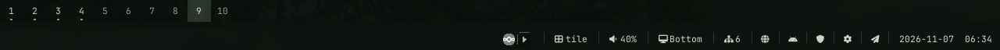

# NIRUBAR

Native X11 status bar for the NIRUX desktop: one bar per monitor, clickable panels and a system tray.

**Status: beta** · Part of the [NIRUX](https://github.com/nirucon/nirux) suite · [MIT License](LICENSE)



## About

NIRUBAR is the bar of NIRUX. It runs as its own process next to NIRUWM, draws
only when a value changes, reserves screen space with an X11 strut and reads
system state directly from `/sys` where it can. It needs no extra daemon and no
NetworkManager.

It shares its configuration, theme and font with NIRUWM, so there is one file
to edit and no duplicated palette. Panels never become a second settings app:
where a real control view exists, the panel hands over to NIRU Launcher.

## Features

- One bar per monitor with monitor-local workspace cells and its own clock.
- A workspace holding a window that asked for attention (NIRUWM 0.19
  urgency) is painted in the theme's attention colour.
- Font-aware layout and semantic theme colours from the active NIRUX theme,
  with the ten built-in palettes when NIRUX is not installed.
- Panels with measured hitboxes (a module is clickable across its whole cell),
  Escape/click-outside dismissal and a timeout.
- XEmbed and D-Bus StatusNotifierItem trays with real icons and menus, on the
  primary monitor.
- Narrow-width overflow: low-priority modules collapse into a clickable `+N`.
- Event-driven media (MPRIS via `playerctl --follow`) and volume (`pactl`
  events), with bounded polling fallbacks.
- Bounded, cached provider queries for package updates and weather.
- Read-only calendar events (ICS feeds such as Google Calendar's secret iCal
  address) in the clock's calendar: day markers, an agenda and click-to-open,
  and a reminder notification before each timed event.
- Optional transparency through the compositor and HiDPI scaling from `Xft.dpi`.

## Requirements

- Debian, Arch or Void Linux (glibc), x86_64, with X11.
- NIRUWM for the workspace cells and dock behaviour (the bar can also run on
  its own).
- Optional providers per module: `playerctl` (media), `pactl` or `wpctl`
  (volume and microphone), BlueZ (Bluetooth), `power-profiles-daemon`
  (power profiles), `tailscale` (Tailscale), `picom` (transparency).
- A Nerd Font for icons; set `icons = false` for plain ASCII labels.
- Building from source: a Rust toolchain (`cargo`).

## Installation

### With NIRUX

NIRUBAR is a core component. `nirux install` installs it with the rest of the
suite and `nirux update` keeps it current. See the
[NIRUX README](https://github.com/nirucon/nirux#installation).

### Standalone

```sh
git clone https://github.com/nirucon/nirubar
cd nirubar
./install.sh
```

`install.sh` builds the release binary with `cargo build --release --locked`
and installs it into `~/.local/bin` (override with `NIRUBAR_PREFIX`). Existing
configuration is preserved. On a NIRUX system use `nirux update` instead.

## Usage

NIRUWM starts one bar per monitor at login. Mouse conventions are the same in
every module:

- **Left click** opens information and never changes playback or mute.
- **Right click** and **scroll** perform the explicit actions (play/pause,
  mute, volume, next profile).
- **Middle click** opens the keyboard-first detail view where one exists.
- One panel is open at a time; Escape or a click elsewhere closes it. A panel
  footer says whether it is informational or has controls; Return or a click
  on that footer opens the control view.

### Modules

Add, remove or reorder modules in `[bar] modules`:

| Module | Shows |
|---|---|
| `workspaces` | Ten workspace cells with active/occupied/urgent state; click to switch |
| `media` | Playing title with a progress hairline; right-click play/pause, scroll previous/next |
| `volume` | Output level or mute; scroll to change, right-click mute, middle-click microphone mute |
| `microphone` | Input mute and gain; right-click mute, scroll gain, middle-click source selector |
| `brightness` | Backlight percentage; hidden without a readable backlight |
| `display` | This bar's screen position; Open controls for display profiles |
| `tailscale` | Tailscale peers, only when Tailscale is installed |
| `network` | Wired link (`!` = link up without a default route) |
| `wifi` | Wi-Fi radio and connection; click opens the Wi-Fi selector |
| `bluetooth` | Off, on or connected device; right-click power |
| `powerprofile` | Active power profile; right-click next profile |
| `battery` | Aggregated battery charge and state |
| `updates` | Available package upgrades (`apt`, `pacman` or `xbps`) |
| `niruxupdate` | A newer NIRUX release, or one that needs a new login |
| `pulse` | CPU and memory; click for a one-minute graph |
| `uptime`, `sun`, `weather` | Uptime, sunrise/sunset, cached weather with an eight-hour rain timeline |
| `mode`, `layout` | Active work mode and NIRUWM's studio mode; current NIRUWM layout |
| `tasks`, `agent` | NIRU/OpenCode task status; OpenCode prompt entry |
| `scratchpad` | NIRUWM scratchpads; click a row to show or hide one |
| `dictation` | NIRUDICTATE recording/transcribing mark |
| `privacy` | A dot while an app uses the microphone, a camera or NIRUCLIP records the screen; click lists the apps |
| `recording` | NIRUCLIP recording timer; right-click stop and save |
| `share`, `nirusec` | NIRUSHARE inbox entry; NIRUSEC state mark |
| `dnd`, `notifications` | Do Not Disturb toggle; notification history |
| `quicksettings` | Gear that opens Quick Settings (volume, Wi-Fi, Bluetooth, displays, power, theme, DND, idle, lock) |
| `clock` | Date and time; click for a Monday-first calendar with ISO week numbers and, when configured, calendar events |

The full module and panel reference is in
[docs/CONFIGURATION.md](docs/CONFIGURATION.md).

### Commands

```sh
nirubar --check-config   # validate the [bar] settings
nirubar --reset-config   # only [bar] back to the defaults (NIRUWM's template with comments), then reload; undo with niructl config undo
nirubar --version
niructl restart-bar      # restart all bars
niructl bar top|bottom|hide|show|toggle
```

## Configuration

Bar settings live in the `[bar]` table of the shared NIRUWM file,
`~/.config/niruwm/config.toml`; colours and font come from the shared theme.
Start from [config.example.toml](config.example.toml).

```toml
theme = "niru-noir"
font_size = 15.0
weather_latitude = 59.33     # for the sun module
weather_longitude = 18.07

[bar]
position = "top"             # or "bottom"; popups then open above
modules = ["workspaces", "media", "volume", "network", "wifi", "battery", "quicksettings", "clock"]
workspace_layout = 1         # 1 numbers (default), 2 icons, 3 text
icons = true
popups = true
popup_timeout_seconds = 4    # quick panels; 0 keeps them open until dismissed
tray = true
transparent = true           # see-through through the compositor
opacity = 94                 # 1-100
```

Other useful keys: `show_title`, `title_max`, `cell_width`, `separator`,
`date_format`, `time_format`, `media_width`, `update_check_minutes`,
`graph_width`, `microphone_visibility` (`always` or `muted`), and
`battery`/`network`/`wifi` switches. Set `NIRU_UI_SCALE` (0.75–2.5) to
override HiDPI detection.

Panels close on a click on the same module, a click elsewhere or Escape.
Quick-glance panels (volume, network, battery, media, ...) also close after
`popup_timeout_seconds`. Reading panels stay open until you dismiss them:
the clock's calendar, `weather` (rain timeline), `tasks`, `pulse` (the load
graph) and `notifications` (history). Give any panel its own timeout in
NIRUBAR's own file, `~/.config/nirubar/config.toml` (not the shared NIRUWM
file), using the names from `[bar] modules`, `calendar` for the clock's panel,
`tray` for tray menus and `overflow` for the `+N` list:

```toml
[popup_timeout]
calendar = 0   # until dismissed (already the default)
volume = 2
weather = 20
```

An override wins over the reading-panel default, which wins over
`popup_timeout_seconds`. See [Panels](docs/CONFIGURATION.md#display-and-panels).

Weather is opt-in: add `weather` to `modules` and create
`~/.config/nirubar/config.toml` from [weather.example.toml](weather.example.toml).

Calendar events are opt-in too: put ICS feed URLs in
`~/.config/nirubar/calendars.toml` (mode 0600, see
[calendars.example.toml](calendars.example.toml)). The clock popup then marks
days with events, lists today and the next `days_ahead` days, and opens the
calendar's page for a clicked day or event in the configured `browser`.
Timed events get a reminder notification 10 minutes before they start
(`remind_minutes` in `calendars.toml`, per calendar or for all, 0 is off). See
[Calendar events](docs/CONFIGURATION.md#calendar-events). Changes to
`calendars.toml` take effect within a few seconds on their own, and at once
with `niructl reload` or `Super+R`; a new or changed calendar is fetched
straight away.

After editing, press `Super+R` or run `niructl reload`.

## Files and paths

| Path | Purpose |
|---|---|
| `~/.config/niruwm/config.toml` | Shared configuration, `[bar]` table |
| `~/.config/nirubar/config.toml` | Optional weather, `[calendar]` and `[popup_timeout]` settings |
| `~/.config/nirubar/calendars.toml` | Calendar feed URLs (secret, mode 0600) |
| `~/.cache/nirubar/calendar/` | Parsed calendar events for offline use (mode 0600) |
| `~/.local/state/nirubar/reminders.json` | Calendar reminders already sent, as hashes (mode 0600) |
| `~/.local/state/niruwm/config-history/` | Earlier versions, one per load and before each reset (shared with NIRUWM) |
| `~/.cache/nirubar/updates` | Cached package-update result |
| `~/.local/bin/nirubar` | Program |

## Troubleshooting

- **Icons show as boxes.** The font lacks Nerd Font glyphs; install one or set
  `icons = false`.
- **The bar is not transparent.** Transparency needs a compositor (picom);
  without one the bar stays opaque.
- **A module is missing.** Modules without a provider hide themselves
  (brightness without a backlight, battery on a desktop, Bluetooth without an
  adapter). Unknown module names are reported on stderr.
- **A setting has no effect.** Run `nirubar --check-config`.
- **The bar runs an old version after an update.** `niructl restart-bar`
  restarts it; a new NIRUWM still needs a new login.

## Uninstall

With NIRUX, use `nirux uninstall`. A standalone install is one file:

```sh
rm ~/.local/bin/nirubar
```

## Building from source

```sh
cargo build --release --locked
cargo fmt --check
cargo clippy --all-targets -- -D warnings
cargo test
sh tests/config-agreement.sh
```

## Status, disclaimer and how it's made

**Status: beta.** NIRUBAR is on every screen I use, every day; new modules
arrive often and some of them are still rough.

NIRUX and every niru* project are made by me, Nicklas Rudolfsson
([@nirucon](https://github.com/nirucon)), for me. They are tailored to my own
needs, preferences and workflows, on my own machines. If they fit yours too,
that's a nice bonus.

- **Free and open source.** Anyone is free to use, study, change and share
  it under the [MIT License](LICENSE).
- **No guarantees.** There is no warranty of any kind. Use it at your own
  risk, read what you install and keep backups of anything that matters.
- **How it's made.** Some of these projects I built from scratch by hand. In
  more recent releases I have used Claude, Anthropic's AI, to do much of the
  heavy lifting under my direction: I decide what to build and how it should
  behave, and I test it on my own machines. It saves me a lot of time, and
  the result is quite OK.
- **Alpha, beta, dev, and maybe forever.** Most things here are alpha, beta
  or dev, and may stay that way. Maybe one day there will be a real stable
  release, but given how fast development moves, and how I am as a person,
  maybe never :)

| Label | Meaning |
|---|---|
| dev | Under active construction; may not build, install or work yet. |
| alpha | Works on my machines, but incomplete or rough; expect breaking changes. |
| beta | In daily use on my machines and mostly complete; rough edges remain. |

## License

MIT License, see [LICENSE](LICENSE). Copyright (c) 2026 Nicklas Rudolfsson.
